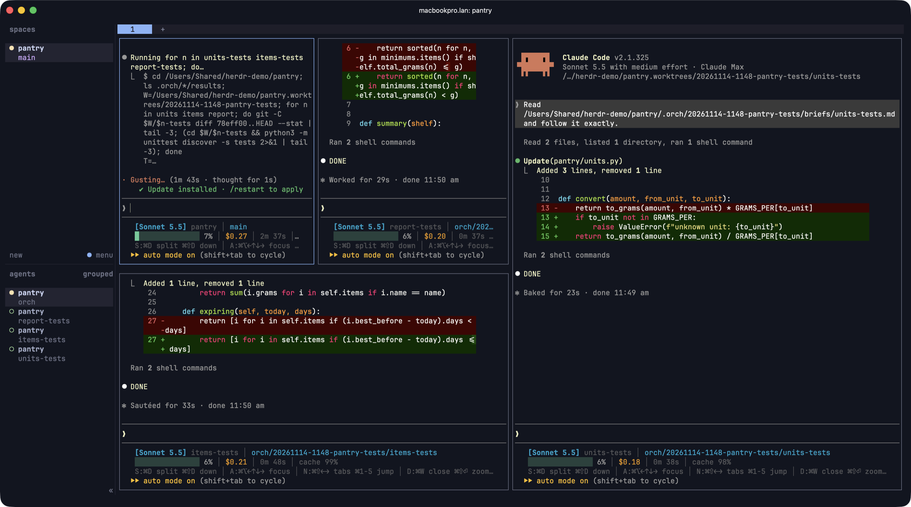

# Claude skills

A small library of [Claude Code](https://claude.com/claude-code) skills. Each folder under `skills/` is a self-contained skill: copy it into `~/.claude/skills/` (every project) or `<repo>/.claude/skills/` (one project), and Claude loads it when a request matches its description.

| Skill | What it does |
|-------|--------------|
| [herdr-orchestrator](skills/herdr-orchestrator/) | Turns one Claude Code session into an orchestrator. It splits a task across worker agents in [Herdr](https://herdr.dev) panes (one git worktree each), picks a model per worker, checks what comes back and writes up the result. |



## Install a skill

```bash
git clone https://github.com/Wisha/claude-skills.git
mkdir -p ~/.claude/skills
cp -R claude-skills/skills/<skill-name> ~/.claude/skills/
```

Each skill's README lists its prerequisites and how to use it. Start `claude` and run `/skills` to check it loaded.

## Licence

[MIT](LICENSE)
