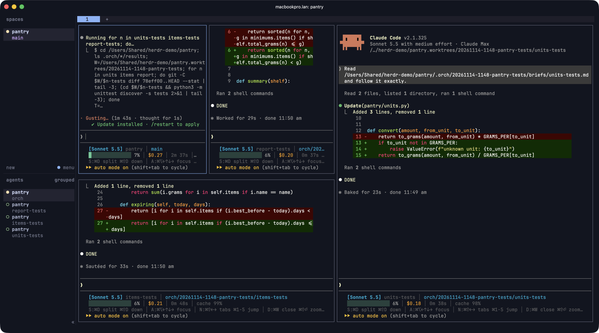

# herdr-orchestrator

This skill turns one Claude Code session into an orchestrator. Claude plans a task, splits it into independent parts and starts a worker agent for each part in its own [Herdr](https://herdr.dev) pane and git worktree. It gives each worker a model suited to its part, checks what comes back and writes up the result.



Each worker gets its own branch (`orch/<run-id>/<name>`). Merging or discarding those branches is up to you: the orchestrator never pushes, merges or deletes branches or worktrees.

## Files

```
SKILL.md                     instructions Claude follows as orchestrator
worker-brief-template.md     the brief each worker receives
scripts/orch-init.sh         starts a run (.orch/<run-id>/ in the repo)
scripts/orch-spawn.sh        creates a worktree and pane, starts a worker on the chosen model
```

## Prerequisites

| Tool | Why | Check |
|------|-----|-------|
| [Claude Code](https://claude.com/claude-code) | Runs the orchestrator and every worker | `claude --version` |
| [Herdr](https://herdr.dev) | Terminal workspace that hosts the worker panes | `herdr --version` (built with 0.9.1) |
| Herdr's Claude integration | Lets Herdr tell when a worker is idle, done or waiting for approval | `herdr integration status` shows `claude: current` |
| git 2.31 or later | Worktrees and `rev-parse --path-format` | `git --version` |
| jq | The scripts read Herdr's JSON output | `jq --version` |
| bash | The scripts run under `/usr/bin/env bash`; macOS's built-in bash 3.2 works | `bash --version` |

You also need a Claude plan with access to the models the skill picks: `haiku`, `sonnet`, `opus` and `fable`. Check each one with `claude -p --model <alias> "Reply ok"`. If one is unavailable, see Customising.

### Install the prerequisites on macOS (Homebrew)

```bash
# Claude Code (skip if installed); then run `claude` once to sign in
curl -fsSL https://claude.ai/install.sh | bash

# Herdr, jq and a current git
brew install herdr jq git

# Herdr's Claude Code integration (installs a hook in ~/.claude/hooks/)
herdr integration install claude
herdr integration status        # expect: claude: current
```

On Linux or Windows, follow the install pages for [Claude Code](https://docs.claude.com/en/docs/claude-code) and [Herdr](https://herdr.dev), then install `jq` and `git` with your package manager.

## Install the skill

```bash
git clone https://github.com/Wisha/claude-skills.git
mkdir -p ~/.claude/skills
cp -R claude-skills/skills/herdr-orchestrator ~/.claude/skills/
chmod +x ~/.claude/skills/herdr-orchestrator/scripts/*.sh
```

To install it for one repository only, copy the folder to `<repo>/.claude/skills/herdr-orchestrator` instead.

Check it loaded: start `claude` and run `/skills`. `herdr-orchestrator` should be in the list.

## Use it

1. Start Herdr in a terminal: `herdr`.
2. In a Herdr pane, `cd` into your git repository and run `claude`. The orchestrator must run inside a Herdr pane: the spawn script needs the `HERDR_PANE_ID` and `HERDR_WORKSPACE_ID` that Herdr sets.
3. Give it a task large enough to split, using a trigger word, for example:
   - "Orchestrate this: add input validation to every API route and write tests for each."
   - "Fan out workers to audit each package in `packages/` for unused dependencies."
   - Or invoke it directly: `/herdr-orchestrator <task>`.
4. Watch the workers appear in new panes. Herdr opens a new tab after every four panes. Progress is tracked in `.orch/<run-id>/ledger.md` in your repo.
5. When it finishes, Claude reports the answer, the evidence and the worker branches to review. The write-up is also saved at `.orch/<run-id>/final.md`.

### Approval prompts

A worker that hits a permission prompt shows as blocked in Herdr's sidebar. The orchestrator never approves prompts for workers: it marks them NEEDS-HUMAN and carries on with other work. Switch to that pane and answer the prompt yourself.

To get fewer prompts, give the repository a `.claude/settings.json` with the permissions your workers need. The spawn script copies it into each worktree when git doesn't track it.

### How it picks models

For each worker the orchestrator asks two questions: how much reasoning the task needs, and how much the brief pins down. The answers map to a model:

| Reasoning / clarity | Example | Model, effort |
|---------------------|---------|---------------|
| advanced / limited | Open design, finding a root cause with no leads | `fable`, high |
| advanced / decent | Design inside a defined slice, security, migrations, review | `opus`, high |
| ordinary / clear | Edits the brief spells out, tests, docs | `sonnet`, medium |
| none / full | Inventories, grep sweeps, running a known command | `haiku`, low |

The classification and the model go in the ledger. A worker that finds a judgement its brief doesn't settle answers `ESCALATE`. The orchestrator then writes a sharper brief or starts a successor worker on a stronger model.

## What the skill creates in your repo

- `.orch/<run-id>/`: goal, briefs, results, ledger and final write-up. `orch-init.sh` adds `.orch/` to `.git/info/exclude`, so git ignores it without changing your `.gitignore`. Some tools still scan untracked folders: if a lint or format check fails on `.orch/`, exclude it there too.
- `../<repo-name>.worktrees/<run-id>/<worker>/`: one worktree per worker, next to your repo.
- Branches named `orch/<run-id>/<worker>`.

Clean up when you've finished with a run's branches:

```bash
git worktree remove ../<repo-name>.worktrees/<run-id>/<worker>
git branch -D orch/<run-id>/<worker>
```

## Customising

- **Different models:** edit the table under "Model choice" in `SKILL.md`. You can also tell the orchestrator in your request, for example "use sonnet for every worker", or put the instruction in your repo's `CLAUDE.md`. An explicit choice from you overrides the table.
- **More or fewer workers:** step 3 of the Method in `SKILL.md` caps runs at 6 live workers.

## Troubleshooting

| Symptom | Fix |
|---------|-----|
| `HERDR_PANE_ID: run inside a Herdr pane` | Start `claude` from a pane inside `herdr`, not from a plain terminal. |
| `missing or invalid --class` or `missing --model` | Expected: the spawn script refuses a Claude worker unless it has a classification and a model. The orchestrator should supply both; if it doesn't, remind it to follow "Model choice". |
| `agent did not start in pane …` | The pane wasn't at a shell prompt. Run `claude` in it by hand, or close it and ask the orchestrator to spawn the worker again. |
| Workers never show as idle or done | Run `herdr integration install claude`, then restart the workers. |
| `fatal: a branch named 'orch/…' already exists` | That worker name was already used in this run. Ask for a different name. |
